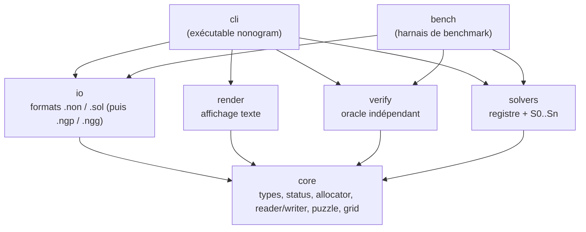

# Architecture

> Dernière revue : 2026-10-25. Les éléments marqués *(cible)* décrivent l'état visé. Ils seront confirmés au fil de l'implémentation.

---

## 1. Vue d'ensemble

Le projet est une **bibliothèque C23 organisée en couches** (`libnonogram`), avec un **exécutable fin** (`nonogram`) qui l'utilise. Chaque couche est une cible CMake distincte. Une dépendance interdite entre couches produit donc une erreur d'édition de liens, pas seulement une remarque en revue. La plateforme est Linux uniquement : Ubuntu sous WSL2 pour le développement, Linux pour la CI et les clusters de calcul.



Quatre idées structurent l'ensemble :

1. **Le cœur ne dépend de rien.** `core` définit les types et ne connaît aucun autre module.
2. **Le vérificateur est un oracle séparé.** `verify` et `solvers` sont deux branches parallèles qui ne se voient pas ([ADR-0007](adr/0007-verificateur-oracle.md)).
3. **Les solvers sont des greffons.** Ils implémentent une interface commune (une table de fonctions) et sont référencés dans un registre statique ([ADR-0005](adr/0005-architecture-modulaire.md)).
4. **La ligne est l'unité de travail.** Les solvers lisent et écrivent des copies de ligne, sans jamais accéder directement au stockage. Ce découplage prépare les grilles massives et la parallélisation ([ADR-0009](adr/0009-types-et-grilles-massives.md)).

## 2. Arborescence

*(cible)*

```
nonogram-solver/
├── AGENTS.md  CLAUDE.md  README.md  CONTRIBUTING.md  CHANGELOG.md  LICENSE
├── CMakeLists.txt          # projet racine : C23, options, warnings, sous-dossiers
├── CMakePresets.json       # dev (GCC), dev-clang, release, asan, ubsan, coverage, fuzz (Ninja)
├── .clang-format  .clang-tidy  .editorconfig
├── tools/docker/Dockerfile # environnement de référence (Ubuntu 24.04, GCC 14, Clang 20), utilisé par la CI
├── include/nonogram/       # API PUBLIQUE uniquement
│   ├── nonogram.h          # en-tête parapluie
│   ├── version.h           # générée par CMake depuis version.h.in (version du project())
│   ├── types.h             # ng_dim, ng_line_id, ng_cell_index, … (ADR-0009)
│   ├── status.h            # ng_status, ng_status_str()
│   ├── allocator.h         # ng_allocator
│   ├── stream.h            # ng_reader, ng_writer (fichier, tampon)
│   ├── puzzle.h            # ng_puzzle (opaque)
│   ├── grid.h              # ng_grid (opaque), ng_cell
│   ├── io.h                # lecture et écriture des formats
│   ├── render.h            # affichage
│   ├── verify.h            # vérification
│   └── solver.h            # interface solver, registre, options, stats
├── src/
│   ├── core/               # status.c allocator.c stream.c puzzle.c grid.c
│   │   └── internal/       # en-têtes ngi_* partagés avec les autres couches
│   ├── io/                 # non_lexer.c non_directives.c non_parser.c non_writer.c non_metadata.c sol_format.c (puis ngp_format.c ngg_format.c)
│   │   └── internal/       # source de caractères par blocs, aides texte (ngi_*)
│   ├── render/             # render_text.c
│   ├── verify/             # verify.c
│   ├── solvers/
│   │   ├── registry.c      # tableau statique des solvers
│   │   ├── common/         # utilitaires partagés entre solvers (pile explicite, trail, file de lignes)
│   │   ├── s0_brute/
│   │   ├── s1_backtrack/
│   │   ├── s2_lineprop/
│   │   └── s3_dp_search/
│   └── cli/                # main.c cmd_show.c cmd_solve.c cmd_verify.c args.c
├── tests/
│   ├── support/            # allocateurs de test, générateur aléatoire, helpers Criterion
│   ├── unit/               # test_<module>.c (Criterion)
│   ├── property/           # tests de propriétés et différentiels
│   ├── integration/        # tests CLI comparés à des fichiers de référence
│   ├── massive/            # tests sur grilles massives (label `massive`, nocturne)
│   ├── fuzz/               # cibles libFuzzer
│   ├── valgrind/           # criterion.supp (suppressions internes à Criterion uniquement)
│   └── data/               # puzzles, solutions, sorties attendues (voir data/README.md)
├── bench/                  # harnais, corpus, paramètres des grilles massives, références
├── scripts/                # setup-wsl.sh check.sh format.sh bench_compare.py update_golden.sh
├── docs/
└── .github/workflows/ci.yml
```

## 3. Modules et dépendances

| Module | Cible CMake | Rôle | Peut dépendre de |
|---|---|---|---|
| `core` | `ng_core` | types, statuts, allocateur, flux (`ng_reader` et `ng_writer`), puzzle, grille | bibliothèque standard uniquement |
| `io` | `ng_io` | analyse et écriture en flux des formats | `core` |
| `render` | `ng_render` | affichage texte du puzzle et de la grille | `core` |
| `verify` | `ng_verify` | vérification d'une grille complète | `core` |
| `solvers` | `ng_solvers` | registre et implémentations | `core` |
| `cli` | `nonogram` | analyse des arguments, orchestration, codes de sortie | tous |
| `bench` | `ng_bench` | mesures de temps et de mémoire | `core`, `io`, `verify`, `solvers` |

**Règles :**

- `verify` et `solvers` ne dépendent pas l'un de l'autre.
- `io` et `render` ne dépendent pas de `solvers`.
- Les en-têtes `src/core/internal/*.h` (préfixe `ngi_`) exposent les accès rapides internes. Ils ne sont **jamais** installés ni inclus depuis `include/`. Les solvers ne s'en servent **pas** pour accéder au stockage des cases (voir §4.4).
- Un solver n'inclut pas les fichiers d'un autre solver. Le code partagé va dans `src/solvers/common/`.
- La bibliothèque installée `libnonogram` regroupe `core`, `io`, `render`, `verify` et `solvers`.
- Tant qu'un module ne contient aucun fichier source, sa cible est une bibliothèque `INTERFACE` qui ne fait que propager `ng_core`. Elle devient une bibliothèque `STATIC` avec son premier fichier source.

## 4. Modèle de données

### 4.1 Types de base (`types.h`)

Ils sont définis par l'[ADR-0009](adr/0009-types-et-grilles-massives.md) et dimensionnés pour les grilles massives :

| Type | Définition | Usage |
|---|---|---|
| `ng_dim` | `uint32_t` | dimensions, longueurs de ligne et de bloc, positions dans une ligne (≤ `NG_DIM_MAX` = 2³¹ − 1) |
| `ng_line_id` | `uint32_t` | identifiant de ligne unifié |
| `ng_run_count` | `uint32_t` | nombre de blocs d'une ligne |
| `ng_cell_index` | `uint64_t` | index linéaire de case, nombre de cases |
| `ng_run_index` | `uint64_t` | position dans le stockage des blocs, nombre total de blocs |
| `ng_counter` | `uint64_t` | statistiques |
| `size_t` | — | tailles mémoire uniquement |

### 4.2 Cases

```c
enum ng_cell : uint8_t {          /* C23 : type sous-jacent fixe */
    NG_CELL_UNKNOWN = 0,
    NG_CELL_EMPTY   = 1,
    NG_CELL_FILLED  = 2,
};
typedef enum ng_cell ng_cell;
```

Ces valeurs sont aussi celles de l'encodage sur 2 bits du format `.ngg` ([ADR-0010](adr/0010-formats-binaires-et-lecture-en-flux.md)).

### 4.3 Puzzle (`ng_puzzle`, opaque)

Implémentation initiale : les indices sont stockés au format **CSR** (*compressed sparse row*), en une seule allocation.

```c
/* src/core/internal/puzzle_layout.h, détail interne susceptible d'évoluer */
struct ng_puzzle {
    ng_dim        width;
    ng_dim        height;
    ng_line_id    line_count;    /* height + width */
    ng_run_index  total_runs;
    ng_run_index *line_offsets;  /* line_count + 1 entrées ; blocs de la ligne L = runs[off[L] .. off[L+1]) */
    ng_dim       *runs;          /* toutes les longueurs de blocs, concaténées */
    /* métadonnées optionnelles (titre, auteur) : copiées dans la même allocation */
};
```

**Identifiants de ligne unifiés** : `0 .. height-1` désignent les rangées, `height .. height+width-1` les colonnes.

**Invariants**, vérifiés à la construction (l'ordre exact des vérifications et le statut renvoyé par chacune sont documentés dans `puzzle.h`) :

- `1 ≤ width, height ≤ NG_DIM_MAX` ;
- toute longueur de bloc est `≥ 1` (une ligne vide n'a aucun bloc) ;
- pour chaque ligne, `somme(blocs) + (nombre_de_blocs - 1) ≤ longueur`, calculé avec `ckd_add` ;
- `somme(blocs des rangées) == somme(blocs des colonnes)`, calculé en `ng_cell_index`.

Une fois construit, un puzzle est **immuable**. Il peut être partagé en lecture entre plusieurs threads.

Pour une grille aléatoire dense, le stockage des indices peut dépasser celui de la grille (environ 2 octets par case, voir l'ADR-0009). L'accès aux indices passe donc uniquement par l'API (§5), ce qui permettra un encodage plus compact sans toucher aux utilisateurs.

### 4.4 Grille (`ng_grid`, opaque)

L'implémentation initiale stocke un octet par case, rangée par rangée, en une seule allocation de `width × height` octets (taille calculée avec `ckd_mul` en `ng_cell_index`). Une représentation compacte à 2 bits par case est prévue avant les benchmarks massifs (M9). Elle restera invisible pour l'API.

**Accès par copie de ligne.** Les solvers ne manipulent jamais le stockage directement :

```c
ng_status ng_grid_load_line (const ng_grid *g, ng_line_id line, ng_cell *buffer);
ng_status ng_grid_store_line(ng_grid *g, ng_line_id line, const ng_cell *buffer);
```

La grille connaît ses dimensions : ces fonctions ne prennent pas le puzzle en paramètre (forme de l'[ADR-0009](adr/0009-types-et-grilles-massives.md)). Le tampon (de longueur `ng_puzzle_line_length(p, line)`, identique pour la grille) appartient à l'espace de travail du solver. Ce choix :

- rend les solvers indépendants de la représentation (octets, bits, partitionnement entre nœuds) ;
- offre un accès contigu, favorable au cache, même pour les colonnes ;
- fait de la ligne l'unité d'échange naturelle d'un solver parallèle.

La copie coûte O(n) par ligne, ce qui est négligeable devant une résolution de ligne en O(n·k). Les accès case par case (`ng_grid_get`, `ng_grid_set`) restent disponibles pour l'affichage, la vérification et les solvers naïfs.

## 5. API publique *(esquisse)*

L'API définitive est documentée en Doxygen dans `include/nonogram/`. L'esquisse ci-dessous fixe la forme générale. Toutes les fonctions qui renvoient `ng_status` sont marquées `[[nodiscard]]` (omis ci-dessous pour la lisibilité).

```c
/* status.h */
enum ng_status : uint8_t {
    NG_OK = 0,
    NG_ERR_INVALID_ARGUMENT,
    NG_ERR_OUT_OF_MEMORY,
    NG_ERR_LIMIT,          /* dimension ou taille non représentable, limite dépassée */
    NG_ERR_PARSE,
    NG_ERR_IO,
    NG_ERR_INCONSISTENT,   /* puzzle trivialement impossible */
    NG_ERR_NOT_FOUND,
    NG_ERR_INTERNAL,
};
typedef enum ng_status ng_status;
const char *ng_status_str(ng_status s);

/* allocator.h */
typedef struct ng_allocator {
    void *(*alloc)(void *ctx, size_t size, size_t align);
    void  (*free)(void *ctx, void *ptr, size_t size);
    void  *ctx;
} ng_allocator;
const ng_allocator *ng_allocator_default(void);   /* enveloppe malloc/free */

/* stream.h */
typedef struct ng_reader { ng_status (*read)(void *ctx, char *buf, size_t cap, size_t *got); void *ctx; } ng_reader;
typedef struct ng_writer { ng_status (*write)(void *ctx, const char *buf, size_t len); void *ctx; } ng_writer;
typedef struct ng_memory_source { const char *data; size_t size; size_t position; } ng_memory_source;
ng_reader ng_reader_from_file(FILE *f);
ng_reader ng_reader_from_memory(ng_memory_source *state, const char *data, size_t len); /* état fourni par l'appelant */
ng_writer ng_writer_from_file(FILE *f);
ng_writer ng_writer_from_buffer(ng_buffer *b);    /* tampon extensible, alloué via ng_allocator */
ng_status ng_buffer_create(const ng_allocator *a, ng_buffer **out);  /* ng_buffer est opaque */
void        ng_buffer_destroy(ng_buffer *b);
const char *ng_buffer_data(const ng_buffer *b);   /* toujours suivi d'un octet nul */
size_t      ng_buffer_size(const ng_buffer *b);

/* puzzle.h */
ng_status    ng_puzzle_create(const ng_allocator *a, ng_dim width, ng_dim height,
                              const ng_dim *runs, const ng_run_index *line_offsets,
                              ng_puzzle **out);
void         ng_puzzle_destroy(ng_puzzle *p);           /* nullptr accepté */
ng_dim       ng_puzzle_width(const ng_puzzle *p);
ng_dim       ng_puzzle_height(const ng_puzzle *p);
ng_line_id   ng_puzzle_line_count(const ng_puzzle *p);
ng_dim       ng_puzzle_line_length(const ng_puzzle *p, ng_line_id line);
ng_run_index ng_puzzle_total_runs(const ng_puzzle *p);
ng_run_count ng_puzzle_line_run_count(const ng_puzzle *p, ng_line_id line);
ng_status    ng_puzzle_copy_line_runs(const ng_puzzle *p, ng_line_id line,
                                      ng_dim *buffer, ng_run_count capacity);

/* grid.h */
ng_status ng_grid_create(const ng_allocator *a, ng_dim width, ng_dim height, ng_grid **out);
void      ng_grid_destroy(ng_grid *g);
ng_dim    ng_grid_width(const ng_grid *g);
ng_dim    ng_grid_height(const ng_grid *g);
ng_cell   ng_grid_get(const ng_grid *g, ng_dim row, ng_dim col);
void      ng_grid_set(ng_grid *g, ng_dim row, ng_dim col, ng_cell c);
void      ng_grid_fill(ng_grid *g, ng_cell c);
ng_status ng_grid_copy(ng_grid *dst, const ng_grid *src);
ng_status ng_grid_load_line(const ng_grid *g, ng_line_id line, ng_cell *buffer);
ng_status ng_grid_store_line(ng_grid *g, ng_line_id line, const ng_cell *buffer);

/* io.h : tous les lecteurs fonctionnent en flux (ADR-0010) */
typedef struct ng_parse_error { uint64_t line; uint64_t column; char message[160]; } ng_parse_error;
typedef struct ng_non_metadata ng_non_metadata;   /* title, author, ... (opaque, séparé du puzzle) */
const char *ng_non_metadata_get(const ng_non_metadata *m, ng_non_field field);  /* nullptr si absent */
void        ng_non_metadata_destroy(ng_non_metadata *m);
ng_status ng_io_read_non(const ng_allocator *a, const ng_reader *r, ng_puzzle **out,
                         ng_non_metadata **metadata /* nullptr : ignorées */, ng_parse_error *err);
ng_status ng_io_read_sol(const ng_allocator *a, const ng_reader *r, ng_grid **out, ng_parse_error *err);
ng_status ng_io_write_non(const ng_puzzle *p, const ng_non_metadata *metadata, const ng_writer *w);  /* P-IO2 */
ng_status ng_io_write_sol(const ng_grid *g, const ng_writer *w);
/* M9 : ng_io_read_ngp / ng_io_write_ngp / ng_io_read_ngg / ng_io_write_ngg */

/* render.h */
typedef struct ng_render_options { bool show_clues; bool unicode; } ng_render_options;
ng_status ng_render_text(const ng_puzzle *p, const ng_grid *g /* nullptr : grille vide */,
                         const ng_render_options *opt, ng_writer *w);

/* verify.h */
enum ng_verdict : uint8_t { NG_VERDICT_VALID, NG_VERDICT_INCOMPLETE, NG_VERDICT_INVALID };
typedef enum ng_verdict ng_verdict;
typedef struct ng_verify_report {
    ng_verdict    verdict;
    ng_line_id    first_bad_line;   /* si INVALID */
    ng_cell_index unknown_cells;    /* si INCOMPLETE */
} ng_verify_report;
ng_status ng_verify(const ng_puzzle *p, const ng_grid *g, ng_verify_report *out);
```

L'affichage texte est destiné aux grilles de taille humaine. Au-delà d'un seuil (`--max-render`, 200 × 200 par défaut), la CLI affiche un résumé (dimensions, nombre de cases connues) au lieu de la grille.

## 6. Interface des solvers

```c
/* solver.h */
enum ng_solve_result : uint8_t {
    NG_SOLVE_SOLVED, NG_SOLVE_UNSOLVABLE, NG_SOLVE_INCOMPLETE, NG_SOLVE_LIMIT_REACHED,
};
typedef enum ng_solve_result ng_solve_result;

typedef struct ng_solve_options {
    ng_counter max_nodes;          /* 0 : illimité */
    uint64_t   max_time_ms;        /* 0 : illimité */
    size_t     max_memory_bytes;   /* 0 : illimité */
    uint32_t   max_solutions;      /* 1 : arrêt à la première ; >1 : comptage */
    uint64_t   seed;
} ng_solve_options;

typedef struct ng_solve_stats {
    ng_counter nodes;              /* nœuds de recherche */
    ng_counter line_solves;        /* appels au solveur de ligne */
    uint64_t   elapsed_ns;
    size_t     workspace_bytes;    /* espace de travail alloué à l'initialisation */
    uint32_t   solutions_found;
} ng_solve_stats;

typedef struct ng_solver_vtable {
    const char *name;              /* "brute", "backtrack", "lineprop", "dpsearch", ... */
    const char *summary;
    bool        complete;          /* trouve toujours une solution si elle existe (hors limites) */
    ng_status (*workspace_size)(const ng_puzzle *p, const ng_solve_options *o, size_t *out);
    ng_status (*init)(void *ws, size_t ws_size, const ng_puzzle *p, const ng_solve_options *o);
    ng_status (*solve)(void *ws, ng_grid *inout, ng_solve_stats *stats, ng_solve_result *res);
} ng_solver_vtable;

const ng_solver_vtable *ng_solver_find(const char *name);
size_t                  ng_solver_count(void);
const ng_solver_vtable *ng_solver_at(size_t index);

/* Fonction de commodité : calcule la taille, alloue l'espace de travail, init, solve, libère. */
ng_status ng_solve(const ng_allocator *a, const ng_solver_vtable *s, const ng_puzzle *p,
                   const ng_solve_options *o, ng_grid *inout,
                   ng_solve_stats *stats, ng_solve_result *res);
```

**Contrat d'un solver :**

1. `workspace_size` est une fonction pure. Elle renvoie la mémoire **totale** nécessaire, calculée avec `ckd_*`, ou `NG_ERR_LIMIT` si cette mémoire dépasse `max_memory_bytes` ou n'est pas représentable.
2. `init` et `solve` **n'allouent pas** de mémoire : tout se fait dans `ws`, que l'appelant fournit.
3. `solve` part de la grille `inout`, qui peut être partiellement remplie (cases déjà connues). Elle ne passe jamais une case connue à `UNKNOWN`.
4. Si le résultat est `SOLVED`, `inout` contient une grille complète. Si le résultat est `INCOMPLETE`, `inout` contient les déductions sûres.
5. Le solver accède à la grille **par lignes** (`ng_grid_load_line` / `ng_grid_store_line`) ou par cases, jamais par un pointeur sur le stockage.
6. La recherche n'utilise **pas de récursion** : elle s'appuie sur une pile explicite dans l'espace de travail. Sa profondeur peut atteindre le nombre de cases, et la pile d'un thread est limitée (8 Mo par défaut sous Linux, souvent moins pour les threads de travail).
7. Tout est déterministe pour une graine donnée.

Ajouter un solver suit la procédure de [agents/PLAYBOOKS.md](agents/PLAYBOOKS.md#p1--ajouter-un-solver).

## 7. Gestion de la mémoire

Le détail est dans l'[ADR-0004](adr/0004-gestion-memoire.md). En résumé :

- Une **allocation par objet** (le puzzle, la grille, l'espace de travail d'un solver), découpée en interne. La mémoire est ainsi prévisible, il y a peu d'appels à l'allocateur et la libération est simple.
- Les calculs de taille utilisent `ckd_add` et `ckd_mul` (`<stdckdint.h>`). Le produit de deux `ng_dim` se calcule toujours en `ng_cell_index`, via `ngi_cell_index()`.
- En test, trois allocateurs remplacent l'allocateur par défaut : un **allocateur défaillant** (échec à la n-ième allocation), un **allocateur compteur** (pic mémoire, nombre d'allocations, fuites) et un **allocateur plafonné** (refus au-delà de N octets), qui permet de tester les grilles massives sans les allouer. Les trois sont réunis dans un même objet, `ng_test_allocator` (`tests/support/test_allocator.h`).
- L'allocateur par défaut refuse (renvoie `nullptr`) une taille nulle, une taille supérieure à `PTRDIFF_MAX` ou un alignement qui n'est pas une puissance de deux.

## 8. Gestion des erreurs

- Toute fonction qui peut échouer renvoie un `ng_status` marqué `[[nodiscard]]`. Les résultats sont passés par pointeurs de sortie.
- En cas d'échec, `*out` vaut `nullptr` (pour les constructeurs) ou n'est pas modifié (le comportement est documenté fonction par fonction).
- Les erreurs d'analyse détaillées passent par `ng_parse_error`.
- `NG_ASSERT(cond)` vérifie les **invariants internes**. Les assertions sont actives en Debug et compilées en `((void)0)` en Release. Elles ne servent jamais à valider des entrées utilisateur.

## 9. Flux d'exécution : `nonogram solve`

```
args ─▶ ng_reader_from_file ─▶ ng_io_read_non ─▶ ng_puzzle
                                                     │
                                  ng_grid_create ◀───┤
                                                     ▼
                     ng_solver_find(name) ─▶ ng_solve ─▶ (grille, stats, résultat)
                                                              │
                                   ng_verify (systématique) ◀─┘
                                                              │
                         ng_render_text / ng_io_write_sol ◀───┘ ─▶ code de sortie
```

La CLI vérifie **toujours** une solution annoncée `SOLVED` avant de l'afficher. Si la vérification échoue, c'est une erreur interne (code de sortie 4) : elle signale un bug du solver.

## 10. Préparation au parallélisme massif

Le parallélisme fera l'objet d'ADR dédiés (étape M9) : d'abord en mémoire partagée (threads), puis distribué (probablement MPI) sur plusieurs centaines de nœuds de calcul. Les contraintes ci-dessous s'appliquent **dès maintenant** pour ne pas fermer cette porte :

| Contrainte | Raison |
|---|---|
| Aucun état global mutable (NF-08) | plusieurs solveurs ou threads de travail dans un même processus |
| Puzzle immuable, accès en lecture seule | partage sans verrou entre threads ; diffusion unique aux nœuds |
| Accès aux cases par copie de ligne (§4.4) | la ligne est l'unité de travail et d'échange ; le stockage peut être partitionné |
| Espace de travail par instance de solver | un espace par thread ou par nœud, sans contention |
| Indices de case sur 64 bits, tailles en `ckd_*` | grilles de 10¹⁰ cases et plus ([ADR-0009](adr/0009-types-et-grilles-massives.md)) |
| Lecture en flux, formats binaires adressables | chaque nœud lit sa portion ([ADR-0010](adr/0010-formats-binaires-et-lecture-en-flux.md)) |
| Déterminisme (NF-12), y compris pour les réductions | résultats et statistiques reproductibles malgré l'ordre d'exécution |
| Statistiques additives (`ng_counter`) | agrégation simple entre threads et nœuds |

Le vérificateur reste séquentiel et simple (ADR-0007). Une variante parallèle, découpée par lignes, pourra être ajoutée pour les grilles massives, à condition d'être testée de façon différentielle contre la version de référence.

**Vocabulaire** : un « nœud » désigne un nœud de **recherche** (une hypothèse). Une machine du cluster s'appelle un « nœud de calcul » dans la documentation, et `rank` ou `worker` dans le code (voir le [glossaire](GLOSSARY.md)).

## 11. Points d'extension prévus

| Extension | Ce que l'architecture prévoit |
|---|---|
| Nouveau solver | Un dossier, une entrée dans le registre, des tests et une spécification (NF-11). |
| Stockage compact (2 bits par case, indices compressés) | Caché derrière l'API d'accès par ligne et par case (M9). |
| Bitsets dans les solvers | Représentation interne à l'espace de travail du solver, alimentée par les copies de ligne (M8). |
| Nouveaux formats | Un nouveau fichier dans `src/io/`. La CLI choisit le format par extension ou via `--format`. |
| Parallélisme (threads, MPI) | §10 ; une cible CMake optionnelle dédiée, pour ne pas imposer MPI aux autres couches. |
| Nonogrammes en couleur | `ng_cell` sur un octet laisse la place à des couleurs. Les indices devront porter une couleur (ADR dédié). |
